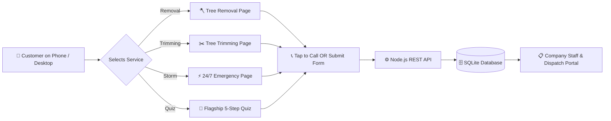

# Exotic Tree Service VA — Web Platform & Lead Engine

> **Domain:** [ExoticTreeServiceva.com](https://exotictreeserviceva.com/)  
> **Mission:** Dominate Virginia tree service competitors (Mathias Precision, Calo Tree Experts, Arbor Care, Mr. Tree) with dedicated service landing pages, 100% mobile conversion, and an automated lead dispatch system.

---

## 🎯 Why You Need To Use This Platform

Most competitor websites in Virginia use slow, bloated WordPress templates with broken forms that lose leads. This platform was custom-engineered to solve those exact problems:

1. **100% Mobile-First Conversion (85%+ of Tree Jobs)**
   - When storms hit or trees fall, homeowners search on their phones.
   - Includes a persistent **Sticky Bottom Bar** with one-tap calling `(703) 991-TREE` and fast quote buttons on every screen.

2. **Dedicated Landing Pages For Your Two Core Services**
   - Instead of lumping everything together, traffic is directed to specific high-converting pages:
     - 🪓 **Tree Removal & Crane Service:** Focuses on tight quarters, hazardous trees, in-house 75-ton crane, and zero yard damage.
     - ✂️ **Tree Trimming & Pruning:** Focuses on ANSI A300 certified standards, 10-ft roof clearance, and canopy health.
     - ⚡ **24/7 Emergency Storm Damage:** Built for rapid 60-minute dispatch and $0 out-of-pocket insurance direct billing.

3. **High-Converting 60-Second Interactive Quiz Funnel**
   - Modeled directly after your existing survey, but modernized with zero friction.
   - Captures property address, service need, tree count, and caller phone number before routing directly to certified arborists.

4. **Built-in Company & Employee Lead Dispatch CRM**
   - Stop losing customer inquiries in spam folders.
   - Office staff and estimators can view incoming leads live, update job statuses (`New` → `Quoted` → `Dispatched` → `Completed`), assign crews, and export to CSV for Excel/QuickBooks.

5. **Cutting-Edge Visual Polish & 3D Interactive Canopy**
   - Three.js 3D foliage and canopy particles that sway organically in the wind.
   - **Dual Theme Switcher:** 1-click toggle between **Forest Emerald & Sun Gold** (Day Mode) and **Midnight Onyx & Amber** (Night Mode).

---

## ⚙️ How This Website Works



1. **Customer Arrival:** Visitor lands on either the Flagship Hub, the Tree Removal page, or the Tree Trimming page.
2. **Action Trigger:** Visitor either taps the phone number to call immediately or completes the 60-second quote form.
3. **Database Capture:** The submission is instantly saved to the SQLite database (`data/leads.db`), which automatically calculates a ballpark estimate.
4. **Crew Dispatch:** Office staff sees the new ticket on the **Staff Portal** (`/portal`), assigns a crew (`Crew Alpha (Crane-1)`, `Crew Bravo`), and contacts the homeowner.

---

## 📂 Project Structure

```
├── package.json               # Backend dependencies & startup scripts
├── server.js                  # Express API & SQLite lead persistence
├── vercel.json                # Zero-config 1-click Vercel deployment
├── data/
│   ├── db.js                  # Real SQLite database connection & queries
│   ├── leads.db               # SQLite database file
│   └── initial-leads.json     # Initial seed lead records
├── public/
│   ├── assets/
│   │   └── logo.webp          # High-resolution client tree emblem logo
│   ├── css/
│   │   └── style.css          # Responsive styling with Dual-Theme engine
│   ├── js/
│   │   ├── main.js            # 5-step quiz engine, price calculator & before/after slider
│   │   ├── three-tree.js      # 3D Three.js interactive foliage & canopy animation
│   │   └── portal.js          # Company & employee dispatch CRM controller
│   ├── index.html             # 🌿 Flagship Hub & 5-Step Estimate Quiz Funnel
│   ├── tree-removal.html      # 🪓 Dedicated Landing Page 1: Tree Removal & Crane Service
│   ├── tree-trimming.html     # ✂️ Dedicated Landing Page 2: Tree Trimming & Pruning
│   ├── emergency.html         # ⚡ Dedicated Landing Page 3: 24/7 Rapid Emergency Response
│   └── portal.html            # 📋 Company & Employee Dispatch CRM Portal
```

---

## 🚀 How To Run & Deploy

### Run Locally:
```bash
npm install
npm start
```
Then visit:
- **Flagship Hub & Quiz:** [http://localhost:3000](http://localhost:3000)
- **Tree Removal Page:** [http://localhost:3000/tree-removal](http://localhost:3000/tree-removal)
- **Tree Trimming Page:** [http://localhost:3000/tree-trimming](http://localhost:3000/tree-trimming)
- **Emergency Page:** [http://localhost:3000/emergency](http://localhost:3000/emergency)
- **Staff Portal:** [http://localhost:3000/portal](http://localhost:3000/portal)

### Deploy to Vercel in 1-Click:
```bash
npx vercel
```
Or connect your GitHub repository directly to Vercel — `vercel.json` is already configured for zero-setup cloud deployment!
